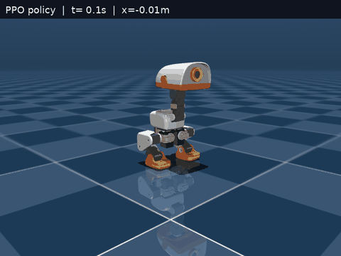
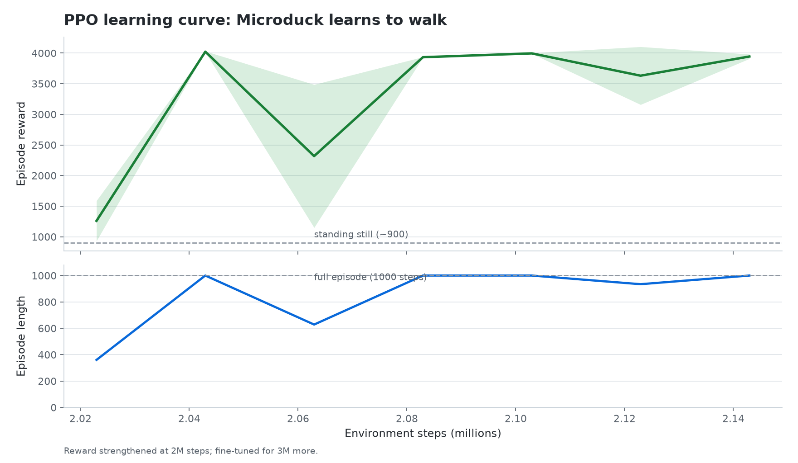
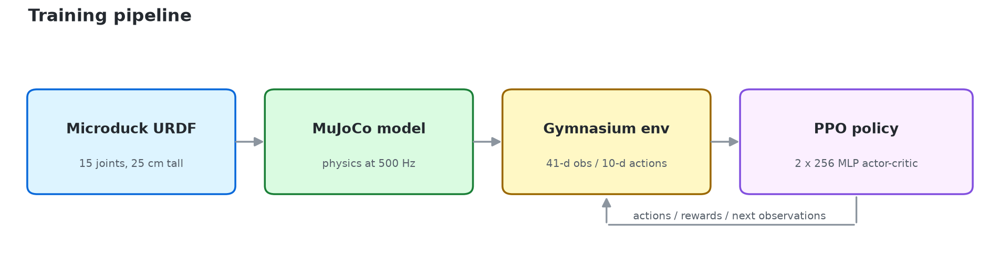

<h1 align="center">Microduck RL Walker</h1>

<p align="center">
  <b>Teaching a 25 cm biped to walk with PPO, MuJoCo, and Stable-Baselines3.</b><br>
  <sub>5M environment steps &nbsp;·&nbsp; 3.5 m mean distance &nbsp;·&nbsp; 9/10 episodes reach 1 m</sub>
</p>

<p align="center">
  
  
  
  
  
</p>

<p align="center">
  
</p>

<p align="center">
  <sub>Trained PPO policy walking 4.2 m in 10 seconds (20 fps recording, 5M training steps).</sub>
</p>

Train the [Microduck](https://pollen-robotics.com/microduck/) biped to walk
forward in MuJoCo using reinforcement learning (PPO from Stable-Baselines3).

This repository is written as a **learning project**: the environment, reward,
training loop, evaluation, and viewer are heavily commented so you can read the
code top to bottom and understand how a real RL pipeline fits together.

**Note:** The previously trained policy was for a different model and is now
stored in `models/old/`. You must retrain on the official Pollen Robotics MJCF
before using `watch.py`/`evaluate.py` with a new policy.

The robot model comes from the official
[Pollen Robotics Microduck](https://github.com/pollen-robotics/microduck)
and [microduck_rl](https://github.com/pollen-robotics/microduck_rl) repositories
(MuJoCo MJCF with meshes). The training scene uses `assets/scene_walk.xml`
(included via `assets/robot_walk.xml`).

---

## Table of contents

1. [Quick start](#quick-start)
2. [Results](#results-on-this-machine)
3. [Project layout](#project-layout)
4. [Reinforcement learning in 60 seconds](#reinforcement-learning-in-60-seconds)
5. [The environment](#the-environment)
6. [Observation space](#observation-space)
7. [Action space](#action-space)
8. [Reward function](#reward-function)
9. [Training with PPO](#training-with-ppo)
10. [Reading TensorBoard](#reading-tensorboard)
11. [Watching, evaluating, and recording](#watching-evaluating-and-recording)
12. [Tuning guide](#tuning-guide)
13. [How the MuJoCo model was made](#how-the-mujoco-model-was-made)
14. [Troubleshooting](#troubleshooting)
15. [License and credits](#license-and-credits)

---

## Quick start

```bash
# 1. Set up Python (creates ./.venv and installs the dependencies)
./build.sh

# 2. Look at the robot
./.venv/bin/python view.py

# 3. Train on the official model (5M steps recommended)
./.venv/bin/python train.py --timesteps 5000000 --n-envs 4

# 4. Watch the trained policy
./run.sh          # or ./.venv/bin/python watch.py

# 5. Evaluate it over 20 fresh episodes
./.venv/bin/python evaluate.py --episodes 20

# 6. Record a README-style GIF and MP4
./.venv/bin/python record.py

# 7. Inspect the learning curves
./.venv/bin/tensorboard --logdir logs
```

If you want a **quick sanity check** that everything is wired up:

```bash
./.venv/bin/python train.py --smoke
```

### Results on this machine

**Using the official Pollen Robotics MJCF model:** no trained policy is
included at this time. The previous policy was trained on a different converted
model and is archived in `models/old/` for reference.

After training on `assets/scene_walk.xml`, update this section and regenerate
`docs/images/` with `./.venv/bin/python record.py` and
`./.venv/bin/python make_figures.py`.

<p align="center">
  
</p>

<p align="center">
  <sub>Training curve will be updated after retraining on the official model.</sub>
</p>

[Download the full-quality MP4](docs/images/microduck_walking.mp4) ·
[View the still frame](docs/images/microduck_walking.png)

---

## Project layout

```
microduck_rl/
├── assets/
│   ├── scene_walk.xml         Training scene (official Pollen model)
│   ├── robot_walk.xml         Official Microduck MJCF
│   ├── joints_properties.xml  Actuator/joint defaults
│   ├── sensors.xml            IMU/sensor definitions
│   ├── additional.xml         Extra defaults/equality
│   ├── config_mjcf_walk.json  MJCF configuration
│   └── meshes/                STL meshes from the official repo
├── docs/images/               GIFs, MP4s, and training figures used by this README
├── microduck_env.py           Gymnasium environment (the RL problem)
├── train.py                   PPO training script
├── evaluate.py                Headless policy evaluation
├── watch.py                   Live MuJoCo viewer for a trained policy
├── view.py                    Inspect the model without a policy
├── record.py                  Render an MP4/GIF of a trained policy
├── make_figures.py            Regenerate the README training curve and diagram
├── build.sh                   Environment setup
├── run.sh                     Launch the viewer
├── requirements.txt
└── README.md
```

---

## Reinforcement learning in 60 seconds

RL is trial-and-error learning with a numerical reward signal. The agent and the
environment interact in a loop:

```
        action a_t
agent ───────────────▶ environment
  ▲                      │
  │  observation o_t+1   │
  │  reward r_t+1        │
  └──────────────────────┘
```

At every control step `t`:

1. The environment gives the agent an **observation** `o_t` (joint angles,
   velocities, body orientation, etc.).
2. The agent's **policy** (a neural network) chooses an **action** `a_t`.
3. The environment simulates that action, moves to a new state, and returns a
   **reward** `r_{t+1}` plus the next observation.
4. The agent updates its policy to get more reward over time.

A **Gymnasium environment** is just a Python class with two main methods:

| Method | Meaning |
|---|---|
| `obs, info = env.reset()` | Start a new episode, return the first observation |
| `obs, rew, terminated, truncated, info = env.step(action)` | Advance one step |

* `terminated` = the episode ended for a task reason (the duck fell).
* `truncated` = the episode ended because of a time limit (not a failure).

**PPO** (Proximal Policy Optimization) is the algorithm used here. It is an
*on-policy* actor-critic method:

* the **actor** outputs a probability distribution over actions,
* the **critic** estimates how much future reward a state is worth,
* after collecting a batch of experience, PPO updates both networks, but clips
  the policy change so it does not destroy what it already learned.

You do not need to implement PPO yourself: Stable-Baselines3 provides it. The
interesting part of an RL project is almost always **the environment and the
reward**.

<p align="center">
  
</p>

<p align="center">
  <sub>From the robot description to a walking policy. The feedback arrow is one PPO rollout.</sub>
</p>

---

## The environment

File: `microduck_env.py`

```python
env = MicroDuckEnv()
obs, info = env.reset(seed=0)
obs, reward, terminated, truncated, info = env.step(action)
```

### Physics

* Model: 25 cm tall Microduck, 15 actuated joints.
* The policy controls the **10 leg joints** (5 per leg).
* The head and jaw are held at zero by their own position servos.
* MuJoCo timestep: **2 ms**.
* The policy acts every 5 physics steps: **10 ms per control step (100 Hz)**.
* Episodes last **1000 control steps = 10 seconds** unless the duck falls.

### Why a crouch pose?

The model starts from a crouched standing pose:

```
left leg:  hip pitch  0.0, knee +1.0, ankle +1.0
right leg: hip pitch  0.0, knee -1.0, ankle -1.0
```

The right leg has mirrored joint axes, so its angles are negated. A crouch is
more stable than straight legs and gives the knees room to push. The policy
learns **residual actions** around this pose instead of learning all joint
angles from scratch.

### Termination

An episode ends early if:

* the trunk drops below **4.5 cm**, or
* the trunk is tilted more than about **66 degrees** (`up < 0.4`), or
* the simulation becomes non-finite (a numerical safety check).

---

## Observation space

Shape: `(41,)`, all `float32`.

| Index | Size | Meaning | Scaling |
|---|---|---|---|
| 0-2 | 3 | Base linear velocity `(vx, vy, vz)` in world frame | `x 5` |
| 3-5 | 3 | Base angular velocity in body frame | `x 0.5` |
| 6-8 | 3 | Gravity direction in the body frame | unit vector |
| 9 | 1 | Trunk height (world z) | metres |
| 10 | 1 | Trunk "up" component (1 = upright, 0 = sideways) | unitless |
| 11-20 | 10 | Leg joint angles relative to the crouch pose | radians |
| 21-30 | 10 | Leg joint velocities | `x 0.1` |
| 31-40 | 10 | Previous action | `[-1, 1]` |

Why these features?

* **Velocities** tell the policy how it is moving.
* **Gravity in the body frame** is a compact way to know the body tilt without
  feeding a quaternion (which has a sign ambiguity).
* **Height and up** directly describe "am I standing?".
* **Joint angles and velocities** describe the current posture and motion.
* **Previous action** lets the policy learn smooth, low-jerk gaits.

Scaling values to roughly `O(1)` is a simple form of feature normalization.
For larger projects, SB3's `VecNormalize` can learn observation statistics
automatically.

---

## Action space

Shape: `(10,)`, continuous, clipped to `[-1, 1]`.

The policy does **not** output joint angles directly. It outputs a normalized
action that is converted to a target angle:

```
target_joint = nominal_pose + mirror * action_scale * action
```

* `nominal_pose` is the stable crouch.
* `mirror` flips the right-leg signs so a positive action has the same physical
  meaning on both legs.
* `action_scale` limits how far each joint can move:
  hip yaw/roll 0.25 rad, hip pitch 0.40 rad, knee 0.50 rad, ankle 0.40 rad.
* Targets are clipped to the joint limits.

The MuJoCo actuators are **position servos**: the commanded value is the
desired joint angle, and an internal PD controller produces the torque.

---

## Reward function

The reward is a shaped sum of terms. Every term is a design choice; changing
them changes the behaviour you get.

| Term | Formula | Weight | Purpose |
|---|---|---|---|
| Forward progress | `3.0 * clip(vx, 0, 0.25) / 0.25` | +3.0 max | Reward any forward motion |
| Speed tracking | `1.0 * exp(-((vx - 0.18) / 0.12)^2)` | +1.0 max | Shape the speed to 0.18 m/s |
| Upright | `0.5 * up` | +0.5 max | Keep the body vertical |
| Height | `0.2 * exp(-((z - 0.087) / 0.02)^2)` | +0.2 max | Stay near crouch height |
| Alive | `0.1` | +0.1 per step | Small survival bonus |
| Sideways drift | `0.5 * vy^2` | penalty | Walk straight |
| Spinning | `0.02 * sum(angular_vel^2)` | penalty | Avoid unwanted rotation |
| Control effort | `0.0005 * sum(target^2)` | penalty | Prefer efficient poses |
| Action jerk | `0.02 * sum((a_t - a_{t-1})^2)` | penalty | Prefer smooth motion |
| Falling | `-10` once | penalty | Make falls clearly bad |

A standing duck earns roughly `0.9` per step. A duck walking at the target
speed earns roughly `4.0` per step, so walking is more than four times better
than standing still. The linear progress term is the key: it gives a useful
gradient as soon as the duck starts moving, which helps PPO escape the
"stand still and collect the alive bonus" local optimum.

---

## Training with PPO

File: `train.py`

```bash
./.venv/bin/python train.py --timesteps 1000000 --n-envs 4
```

What the script does:

1. Creates 4 copies of the environment (`DummyVecEnv`). Four parallel ducks give
   a less correlated and more diverse batch of experience.
2. Wraps each env in `Monitor`, which records episode reward and length.
3. Creates a separate evaluation environment.
4. Trains PPO with:
   * `n_steps=1024` rollout steps per env,
   * `batch_size=256`,
   * `n_epochs=10` passes over each rollout,
   * `gamma=0.99` discount factor,
   * `gae_lambda=0.95` advantage smoothing,
   * `clip_range=0.2` PPO trust region,
   * `ent_coef=0.01` exploration bonus,
   * a 2x256 MLP policy.
5. Saves checkpoints every ~50k env steps.
6. Evaluates every ~20k env steps and saves the best model.
7. Saves the final model to `models/microduck_ppo.zip`.

Useful flags:

```bash
--timesteps 2000000    # train longer
--n-envs 8             # more parallel experience (needs CPU/GPU headroom)
--resume               # continue from models/microduck_ppo.zip
--smoke                # 4096-step pipeline test
--seed 1               # try a different random seed
```

Training runs can be resumed:

```bash
./.venv/bin/python train.py --resume --timesteps 1000000 --n-envs 4
```

### Where do the files go?

```
models/
├── microduck_ppo.zip          final policy
├── checkpoints/               periodic snapshots
└── best/best_model.zip        best evaluation policy
logs/
├── microduck_ppo_*/           TensorBoard scalars
└── eval/evaluations.npz       evaluation history
```

---

## Reading TensorBoard

```bash
./.venv/bin/tensorboard --logdir logs
```

Then open the URL it prints (usually <http://localhost:6006>).

Key metrics:

| Metric | What it means |
|---|---|
| `rollout/ep_rew_mean` | Average episode reward. Should trend up. |
| `rollout/ep_len_mean` | Average episode length. Falling early shortens it. |
| `train/entropy_loss` | Policy randomness. Should slowly decrease. |
| `train/approx_kl` | How much the policy changed per update. Large values (>0.05) suggest instability. |
| `train/explained_variance` | How well the critic predicts returns. Near 1 is good. |
| `train/value_loss` | Critic error. |
| `train/policy_gradient_loss` | Actor loss (hard to interpret in isolation). |
| `time/fps` | Simulation throughput. |

A healthy run usually shows reward rising, episode length approaching 1000, and
explained variance rising above 0.5. It may be noisy early on.

---

## Watching, evaluating, and recording

### Live viewer

```bash
./.venv/bin/python watch.py
./.venv/bin/python watch.py --model models/best/best_model.zip
./.venv/bin/python watch.py --stochastic
./.venv/bin/python watch.py --episodes 3
```

* `--episodes 0` runs until you close the window.
* `--stochastic` samples actions instead of using the mean.
* Camera: left-drag rotates, right-drag pans, scroll zooms. Press `Esc` to close.

### Headless evaluation

```bash
./.venv/bin/python evaluate.py --episodes 20
```

Reports mean reward, mean distance, fall rate, and success rate. Evaluation uses
fresh seeds so it measures generalization rather than memorized starting
states.

### Inspect the model without a policy

```bash
./.venv/bin/python view.py            # gravity off, floating
./.venv/bin/python view.py --gravity  # let it settle on the floor
```

### Record a video or GIF

```bash
./.venv/bin/python record.py
./.venv/bin/python record.py --seed 5000 --width 640 --height 480 --fps 20
```

`record.py` renders offscreen, so it does not need a visible window. It writes
three files to `docs/images/`:

* `microduck_walking.mp4` - full-quality H.264 video,
* `microduck_walking.gif` - the inline preview used at the top of this README,
* `microduck_walking.png` - a still frame.

The HUD in the recording shows the simulation time and forward distance. Change
`--seed` to record a different evaluation episode.

### Make the README figures

The training curve is plotted from `logs/eval/evaluations.npz`, which the
`EvalCallback` writes during training. `make_figures.py` regenerates both the
training curve and the pipeline diagram:

```bash
./.venv/bin/python make_figures.py
```

Run it after training to update the curve with your own results.

---

## Tuning guide

If training is not working, change one thing at a time.

### The duck falls immediately

* Lower `target_speed` in `MicroDuckEnv` (e.g. 0.12).
* Increase the `alive_bonus` or the `upright_reward` weight.
* Increase `--n-envs` so more diverse falls are seen per update.
* Train longer; 1M steps is a starting point, not a guarantee.

### The duck stands still

* Increase the speed reward weight or decrease the alive bonus.
* Increase the Gaussian width `speed_sigma` so slow movement is rewarded.
* Check that the action scale gives the legs enough range.

### The duck jitters

* Increase the action-jerk penalty (`smooth_penalty`).
* Decrease `action_scale`.
* Increase `n_steps` so updates are based on longer horizons.

### Training is unstable

* Lower `learning_rate` to `1e-4`.
* Reduce `n_epochs` to 5.
* Lower `clip_range` to 0.1.
* Check `train/approx_kl`; if it is consistently above 0.05, the updates are too
  large.

### Simulation is slow

* MuJoCo is usually CPU-bound. Reduce `--n-envs` if the CPU is saturated.
* The visual meshes do not affect physics much, but collision boxes do.
* `DummyVecEnv` is single-process; for very large runs try `SubprocVecEnv`.

---

## How the MuJoCo model was made

The model comes directly from the official
[Pollen Robotics microduck_rl](https://github.com/pollen-robotics/microduck_rl)
repository:

1. **Official MJCF**: `assets/robot_walk.xml` and related files
   (`additional.xml`, `joints_properties.xml`, `sensors.xml`,
   `config_mjcf_walk.json`) were pulled from
   `src/mjlab_microduck/robot/microduck/` on branch `develop`.
2. **Training scene**: `assets/scene_walk.xml` includes the robot and adds a
   floor, skybox, lighting, and keyframes (used for inspection/reset).
3. **Meshes**: STL meshes from `assets/` in the official repo were copied to
   `assets/meshes/`. `robot_walk.xml` uses `meshdir="meshes"`.
4. **Actuators**: 14 position servos for the leg/head joints; the policy
   controls the 10 leg joints (`hip_yaw`, `hip_roll`, `hip_pitch`, `knee`,
   `ankle` for both legs), head joints are held at zero.

---

## Troubleshooting

**`ModuleNotFoundError: No module named 'stable_baselines3'`**

The `.venv` symlink is broken. Re-run `./build.sh`.

**`No policy found at models/microduck_ppo.zip`**

Train first:

```bash
./.venv/bin/python train.py --timesteps 1000000 --n-envs 4
```

**The viewer opens but the duck is not visible**

The Microduck is only 25 cm tall. Zoom in with the scroll wheel or use the
camera settings in `watch.py` / `view.py`.

**`mujoco.viewer` fails on a headless machine**

The viewer needs a display. Training and `evaluate.py` work headless; only
`view.py` and `watch.py` need a desktop session.

**Training is much slower than expected**

Check `nvidia-smi` and `htop`. PPO's neural-network updates use the GPU, but the
MuJoCo simulation runs on the CPU. On a laptop GPU, keeping `--n-envs 4` is
usually a good balance.

---

## License and credits

* Robot model and meshes: [pollen-robotics/microduck](https://github.com/pollen-robotics/microduck)
  and [pollen-robotics/microduck_rl](https://github.com/pollen-robotics/microduck_rl)
  (see their LICENSE files for terms).
* Microduck is a robot by [Pollen Robotics](https://pollen-robotics.com/microduck/).
* RL stack: [MuJoCo](https://mujoco.org/),
  [Gymnasium](https://gymnasium.farama.org/),
  [Stable-Baselines3](https://stable-baselines3.readthedocs.io/).

This project is for learning and experimentation. Always check the upstream
licenses before redistributing meshes or model files.
